<div align="center">

```
 ███╗   ███╗ █████╗ ███████╗███████╗
 ████╗ ████║██╔══██╗██╔════╝██╔════╝
 ██╔████╔██║███████║███████╗███████╗
 ██║╚██╔╝██║██╔══██║╚════██║╚════██║
 ██║ ╚═╝ ██║██║  ██║███████║███████║
 ╚═╝     ╚═╝╚═╝  ╚═╝╚══════╝╚══════╝
```

### Multi-Agent Supervision System

*A runtime for managing AI agents beyond a terminal session.*

[](#build)
[](harness/bindings/http.md)
[](#current-status)
[](LICENSE)

**Create** · **Supervise** · **Interact** · **Observe**

[Quick start](#quick-start) · [Architecture](#architecture) · [Documentation](#documentation)

</div>

---

MASS gives applications a common way to start agent runtimes, create sessions,
send work, observe progress, and retrieve results. The goal is to make agents
manageable as services, with explicit lifecycles and a history you can return to.

## What is MASS?

Running an agent once is straightforward. Building a service around agents means
keeping track of which sessions exist, what they are doing, what they need from
you, and what happened while you were away.

MASS brings those concerns together behind a CLI and an HTTP API. It draws
inspiration from container runtimes: give different execution backends a common
management interface, while leaving agent-specific behavior to their drivers.

Use it as the execution layer beneath an orchestrator, an automation service,
or your own agent interface.

## What you get

| | Capability | What it gives you |
|:---:|---|---|
| 🔌 | **Agent as a service** | A named Runtime you can configure, start, inspect, and stop. |
| 💬 | **Session management** | Conversations with a working directory, input, cancellation, archive, and resume through the runtime driver. |
| 👁️ | **Live events & history** | Watch progress as it happens and query saved events when you return. |
| 🤝 | **Interactive agents** | Permission requests and questions exposed to the calling application. |
| ⚡ | **CLI + HTTP API** | Use `massctl` at the terminal or connect your own application through REST JSON and SSE. |

These are the core responsibilities of v2. The implementation is still a
prototype; see [current status](#current-status) for its present limits.

## From v1 to v2

v1 became too complicated. It accumulated too many concepts, layers, and features
that did not help enough with the core job of managing agents. v2 simplifies the
project and removes much of that unnecessary functionality, including the old
workspace-management, compose, and interactive TUI surface.

> 🎯 **Same goal, simpler system.** Make AI agents manageable as services through
> a common interface for their lifecycles, sessions, interactions, and history.

| v1 | v2 |
|---|---|
| Agent, Workspace, and AgentRun abstractions | Runtime and Session as the core user-facing concepts |
| Workspace management, compose, and an interactive TUI | A focused daemon, CLI, and HTTP API |
| Public JSON-RPC interface | REST JSON resources with optional SSE observation |

## Architecture



`massctl` and API clients run outside `massd` and connect over HTTP. Inside
`massd`, the HTTP API calls Service, which coordinates Store and Runtime. Store
saves resources and history; Runtime uses agent drivers and SDKs to launch and
communicate with external Agent processes, such as Codex and Claude.

Two concepts carry most of the user-facing model:

| Concept | Meaning |
|---|---|
| 🔌 **Runtime** | A named agent backend and its configuration, such as a Codex or Claude driver. |
| 💬 **Session** | A conversation owned by a Runtime, with a working directory, state, and event history. |

Live observation and saved history serve different purposes. SSE shows new
events; history queries retrieve committed events. Closing a watch does not
cancel agent work.

The [interactive diagram](docs/assets/mass-v2-architecture.html)
includes source references. The [architecture contract](harness/architecture.md)
describes the intended design in detail.

## Build

Requires **Go 1.26.9 or later**.

```sh
make build
# Produces bin/massctl and bin/massd-go
```

| Binary | Role |
|---|---|
| `bin/massd-go` | 🛠️ Daemon — serves the API and manages runtimes, sessions, and history. |
| `bin/massctl` | ⌨️ CLI — talks to the daemon over HTTP. |

## Quick start

To explore the current prototype, run the isolated synthetic demonstration:

```sh
make prototype-go
```

It builds mock Codex and Claude CLIs and exercises session creation, input,
interaction, live events, history, cancellation, archive, and resume through the
actual MASS CLI and HTTP service. It uses temporary data and working directories
and does not call a model or require an agent account. Its pinned dependencies
must already be cached.

To start the local service separately:

```sh
bin/massd-go --local
```

In another terminal:

```sh
bin/massctl runtime list
bin/massctl runtime --help
bin/massctl session --help
```

| Local default | Value |
|---|---|
| 🌐 Service address | `http://127.0.0.1:24368` |
| 📂 Data directory | `~/.mass/data` |
| ⚙️ Configuration | `~/.mass/config.yaml`, when present; flags override file values |

`--local` selects trusted single-user loopback access.
See the [Go implementation guide](mass-go/README.md) for configuration and API
usage, subject to the driver limits below.

## Current status

v2 is being developed in Go under [`mass-go/`](mass-go/README.md).

| Area | Available today | Current limit |
|---|---|---|
| 🛠️ Service | HTTP API, CLI, and file-backed resource/history storage | Prototype implementation |
| 🧩 Agent drivers | Codex and Claude SDK adapters | Both require an executable **and a synthetic scenario**; an installed agent CLI alone is insufficient |
| 🧪 Demonstration | Isolated CLI → HTTP → Service → Store / Runtime scenarios | Uses mock CLIs; does not establish real model execution, native recovery, or production readiness |
| 💬 Claude input | Text input, archive, and resume | One input per running connection |
| 🤝 Permissions & questions | HTTP answer API | No CLI answer command yet |

## Development

| Command | Purpose |
|---|---|
| `make fmt` | Format Go code |
| `make lint` | Run Go lint |
| `make test` | Run offline tests with the race detector |
| `make build` | Build the daemon and CLI |
| `make check` | Run lint, tests, build, and formatting checks |
| `make prototype-go` | Run the isolated synthetic end-to-end demonstration |

## Documentation

| Guide | Read it for |
|---|---|
| 📘 [Go implementation](mass-go/README.md) | Configuration, commands, and implementation limits |
| 🧭 [Project harness](harness/index.md) | Authoritative design, principles, and API contracts |
| 🌐 [HTTP API](harness/bindings/http.md) | REST JSON resources and optional SSE observation |
| 🧪 [HTTP acceptance](mass-go/docs/http-v1-acceptance.md) | Implementation validation and its scope |

The HTTP API's **v1** version is separate from the project's **v2** redesign.

## License

[Apache License 2.0](LICENSE). See [NOTICE](NOTICE) for third-party notices.
